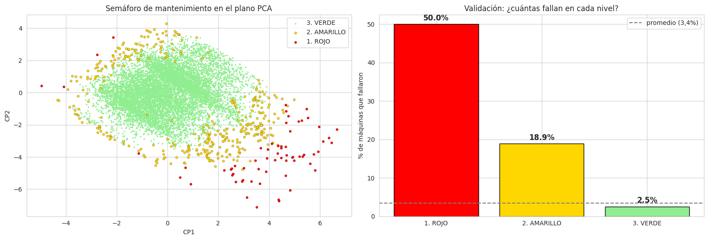

# Predictive Maintenance without Failure Labels — AI4I 2020

Unsupervised learning on the **UCI AI4I 2020 Predictive Maintenance** dataset (10,000 machine operating records) to answer a business question: *which machines should the maintenance team inspect first, and what should they check?* The failure labels are **never used to fit the models**, only to validate them afterwards.

> 🇪🇸 *Mantenimiento preventivo con aprendizaje no supervisado: PCA, K-medias, K-medoides y DBSCAN para construir un semáforo de prioridad de revisión. Notebook en español.*



## Results

| Priority | Share of machines | Failure rate | × average | Share of all failures |
|---|---:|---:|---:|---:|
| 🔴 Red | 0.7 % (66) | 50.0 % | 14.7× | 9.7 % |
| 🟡 Yellow | 3.7 % (366) | 18.9 % | 5.6× | 20.4 % |
| 🟢 Green | 95.7 % (9,568) | 2.5 % | 0.7× | 69.9 % |

- **Inspecting 4.3 % of machines (red + yellow) anticipates 30 % of failures**, about 7× better than inspecting the same number at random.
- The suggested action per machine (low power, overload, heat, wear) matches the real failure type for flagged machines that failed.
- Parameters were chosen with silhouette and elbow criteria only, so the method transfers to plants that have no failure history.

## Method

| Step | Details |
|---|---|
| EDA | Sensor distributions, failure types, physics-based features used only to understand failures |
| PCA | 5 standardised sensors → 3 interpretable components (temperature, mechanical power, wear), 95 % of variance |
| K-means / K-medoids | Operating regimes (K = 3, plus K = 6 for detail); agreement between methods ARI = 0.70 |
| DBSCAN | `min_samples` = 2 × features, `eps` from the k-distance elbow; noise points have **7× the average failure rate** |
| Business layer | Traffic-light priority from DBSCAN, per-machine "what to check" from the most extreme variable, illustrative cost example |

## Limitations

The dataset is synthetic. The approach is strong for failures under extreme conditions (power, overstrain) and weaker for heat-dissipation and wear failures that come from combinations of normal values, so 70 % of failures remain in green and routine maintenance is still needed.

## How to run

```bash
pip install -r requirements.txt
jupyter notebook ai4i_predictive_maintenance.ipynb
```

The data are downloaded from the UCI repository at run time.

## Authors

Group project by Laura León, **Mateo Aranguren** and Jonathan Galindo.

## Stack

Python · scikit-learn · scikit-learn-extra · kneed · pandas · seaborn · matplotlib
